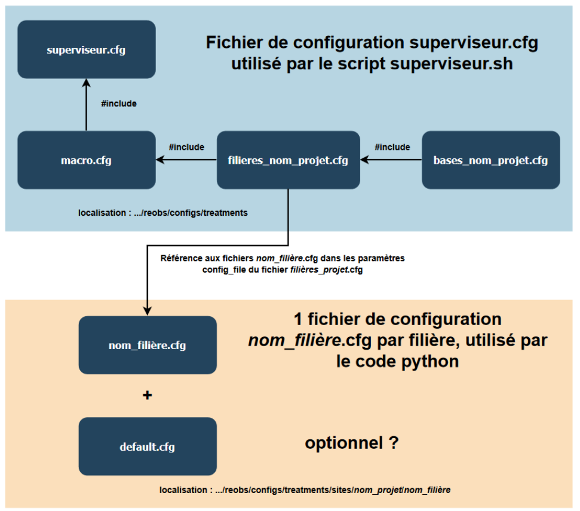

# Travail effectué

## Prise en main

Les catégories dans ReOBS Avant de s'intéresser au travail réalisé il
est important de comprendre l'outil sur lequel j'ai travaillé. C'est une
étape qui a été importante pour moi lors de mes premiers jours mais
c'est également une étape primordiale pour avoir une compréhension
claire du document présent. Premièrement, on nommera "traitements" les
opérations effectuées sur les données. Dans les fichiers de
configuration liés à ReOBS, l'un répertorie les différents traitements
qui seront effectués sur les données dans une forme de liste :

```toml
[nom du traitement 1]
détails du traitement

[nom du traitement 2]
détails du traitement
...
```

Grâce à un fichier répertoriant les traitements on sait quoi faire avec
les données. Mais où sont obtenues ces données ? Ces données proviennent
d'un autre fichier de configuration répertoriant les "bases". Chaque
base contient un chemin vers un fichier de données sous un certain
format et le répertoire dans lequel les données se situent ainsi que
certaines informations complémentaires sur les données comme par exemple
leur résolution temporelle. On connaît donc notre manière de répertorier
les données et notre manière de les traiter. Mais comment associer ces
deux informations? Cela est fait avec un autre fichier de configuration,
celui des "filières". Une filière utilise une ou plusieurs bases pour
indiquer les données qui seront lues, puis une base pour indiquer où et
comment stocker le résultat final. La filière indique également où
trouver le fichier répertoriant les traitements à effectuer sur les
données mises en entrée. La filière effectue donc un rôle de passerelle
entre les données et les traitements qui seront faits dessus. Enfin,
pour donner du contexte à ces bases,filières et traitements, il existe
une entité de "projet" qui contient diverses informations : le nom du
projet pour lequel ces données sont utilisées, la liste de toutes les
filières et bases utilisées dans le projet, la version actuelle du
projet et autres indications non techniques. La liste des différents
projets est stockée dans un fichier nommé superviseur.cfg.

Enfin voici un schéma récapitulant les informations que nous venons de
couvrir. Il contient quelques coquilles car est légèrement daté mais
donne tout de même un bon aperçu du fonctionnement des fichiers de
configuration de ReOBS. Sa taille nous permet de constater la complexité
de ReOBS, et donc la nécessité du projet sur lequel je travaille.



Figure 4.a.1 : Schéma expliquant l'architecture des fichiers de
configuration de ReOBS - Source : Rapports de stages précédents

Les fichiers de configuration Chaque fichier de configuration est
composé de une ou plusieurs sections qui se présente comme ceci :

```toml
[meteoairsol_air]
processing_name= "Lecture des fichiers la"
processing_code= ${sirta:code_dir}/core/data_stream.py
config_file = ${sirta:conf_site_dir}/meteosirta_air/meteoairsol_air.cfg
input= $[base_meteoairsol_air]
output= $[base_meteoairsol_air_reobs]
time_division = "5 years"
```

Dans une section on retrouve plusieurs parties, d'abord l'entête de la
section, ici :

```toml
[meteoairsol_air]
nom de la section
```

Cet entête contient le nom de la section traitée. On retrouve ensuite le
corps de la section, là où on rentre les informations qui seront
utilisées par ReOBS. Les informations fonctionnent par paire
clef/valeur. Par exemple ici :

```toml
time_division = "5 years"
 clef             valeur
 ```

La clef "time\_division" a pour valeur "5 years". On pourrait se
demander ce que signifie 5 years dans ce cadre, ou se poser des
questions sur les différentes clefs et valeurs. Bien que ce soit des
questions qui ont évidemment des réponses, dans le cadre de mon projet
de remplissage de ces fichiers de configuration par formulaires ce n'est
pas important. C'est un aspect que j'ai travaillé car important pour
rendre intuitive l'interface mais qui n'est pas utile pour comprendre
les opérations techniques effectuées sur les fichiers, je ne rentrerais
donc pas dans les détails de chaque clef ou valeur.
